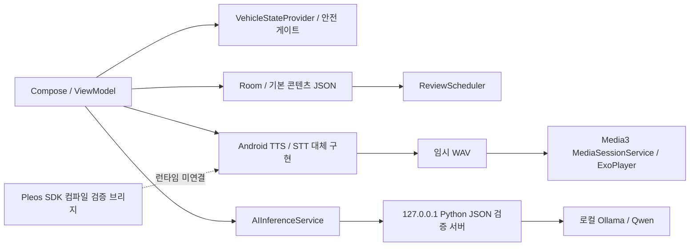

# DRIVE TALK AI 시스템 구조

독립 Android 프로젝트. YEOPJARI 소스/이력을 변경하지 않는다. Kotlin + Compose + StateFlow + Room + Media3, Python 표준 라이브러리 로컬 AI 브리지를 사용한다.

## 모듈과 교체 지점

| 경로 | 역할 |
|---|---|
| app/.../ui | 화면, 세션, 명시적 모드 선택, 주차 상태 재검사 |
| app/.../learning | Lesson/Progress, 콘텐츠·기록 저장 인터페이스 |
| app/.../personalization | 순수 Kotlin SRS, 엄격한 음성 명령 파서 |
| app/.../data | Room entity/DAO/transaction, 자산 로딩, DB migration |
| app/.../speech | SpeechRecognitionService, SpeechSynthesisService, Android 대체 구현 |
| app/.../audio | AudioPlaybackController, Media3 서비스와 미디어 세션 |
| app/.../vehicle | VehicleStateProvider, UNKNOWN 기본값, DEMO 제공자 |
| app/.../ai | AIInferenceService, 로컬 HTTP 구현, 타임아웃/재시도/응답 검사 |
| pleos-adapters | 실제 SDK를 참조하는 STT/TTS·기어 조회 브리지. 앱과 연결되지 않은 별도 라이브러리 |
| ai-server | Ollama 호출, 입력·출력 스키마/언어/길이 검증, 프롬프트 파일 |

앱 패키지: `ai.drivetalk`. 외부 DI 프레임워크 없이 AndroidViewModel에서 작은 규모로 의존성을 조립한다. Qwen 서버를 차량 온디바이스 추론으로 교체할 때는 `AIInferenceService`를 구현하면 된다. 현재 차량 내 Qwen 실행을 구현하거나 검증하지 않았다.

## 학습 데이터 흐름

1. 사용자가 카테고리·수준·문장 개수·문장 사이 쉬는 시간을 설정하고 출근/퇴근 모드를 명시적으로 선택한다.
2. 기본 예문은 `assets/lessons/lessons.json`의 54개 자체 작성 예문이다. 3카테고리 × 3수준 × 6문장.
3. 출근 모드는 선택한 수준·카테고리 예문을 중복 없이 선택 개수만큼 학습한다. 선택 개수보다 콘텐츠가 적으면 실제 준비된 개수로 진행한다. 퇴근 모드는 이미 청취/평가한 예문을 SRS 순위로 정렬한다.
4. Android TTS가 영어·한국어·영어 WAV를 만들고 2초 PCM 쉼을 사이에 삽입하여 Media3로 재생한다. 문장 사이에는 기본 8초의 따라 말할 시간을 주며 일시정지하면 이 대기도 멈춘다.
5. 세 문장 청취가 끝났을 때만 LISTEN 이벤트와 청취 횟수를 저장한다. 중간 건너뛰기/종료는 완전 청취로 집계하지 않는다.
6. 실제 미디어 재생 중인 초(언어 사이 PCM 쉼 포함)를 세션 테이블에 매초 저장한다. 시간은 통계일 뿐 세션 종료 기준이 아니다. 일시정지·준비 시간은 제외한다. 초 단위 근사값이다.
7. 정답/오답/어려움은 주차 상태에서 사용자가 직접 평가할 때만 변경한다.
8. 기록/생성 콘텐츠는 로컬 Room에 저장한다. 설정에서 전체 삭제한다. Android 백업을 비활성화했다.

현재 사용자 ID는 단일 `local` 사용자다. 수준·카테고리·학습 문장 개수·문장 사이 쉼·준비 시간은 로컬 SharedPreferences에 저장한다. 다중 계정 UI, 계정 인증, 차량 사용자 프로필 매핑은 미구현이다.

## Room 데이터

- ProgressEntity: 사용자/콘텐츠 복합키, 청취·정답·오답 횟수, 어려움, 간격, 마지막 청취·평가, 다음 복습.
- EventEntity: LISTEN/AGAIN/HARD/GOOD 이벤트와 발생 날짜(밀리초 epoch).
- GeneratedEntity: 실제 Qwen 생성/회화 교정 문장과 수준·카테고리·출처.
- SessionEntity: 출근/퇴근 명시 모드, 수준·카테고리, 시작/종료, 청취 시간.
- DB v1→v2는 세션 테이블만 추가하는 migration이다. 파괴적 migration은 사용하지 않는다.

## SRS

| 직접 평가 | 다음 간격 | 성취도 기록 |
|---|---|---|
| 다시 학습 AGAIN | 10분 | 오답 +1, 어려움=true, 일 간격 초기화 |
| 어려워요 HARD | 1일 | 정·오답 변화 없음, 어려움=true |
| 알겠어요 GOOD | 1, 2, 4, 8, 16, 30일(상한) | 정답 +1, 어려움=false |
| 청취만 완료 | 변경 없음 | 청취 +1, 정·오답 변화 없음 |

복습 순위: 어려움 → 기한 도래 → 오늘 청취 → 예정 시각 오름차순. 아직 기록이 없는 항목은 복습에 포함하지 않는다. 현재 선택한 카테고리/수준 내에서만 복습한다. 새로운 수준으로 변경하면 이전 수준의 복습은 해당 수준으로 돌아가서 확인한다. 기한 미래 항목도 사용자가 명시적으로 복습을 시작하면 후순위로 포함될 수 있다.

## AI 계약

`POST /generate`: `{level, category, expression, previous_examples?}`（최근 영어 예문 최대 6개, 생략 가능） → `{english,korean,source,elapsed_ms,validation}`.

`POST /question`: `{level,turn}`(0~4) → `{question,source,elapsed_ms,validation}`.

`POST /feedback`: `{answer,language}` → `{corrected,explanation,uncertain,source,elapsed_ms,validation}`.

`GET /health`: 설치된 모델 여부를 반환한다. health 성공을 추론 성공으로 표시하지 않는다.

사용자 ID, 기록 전체, 오디오, 위치 정보는 AI 브리지로 전송하지 않는다. 대화 원문 요청 로그를 남기지 않는다. 앱은 사용자 답변 텍스트 최대 500자만 개발 PC의 로컬 모델에 보낸다. 질문은 턴별 주제를 사용하며 이전 대화 전체를 전송하는 문맥형 회화는 미구현이다.

서버는 루프백에만 바인딩한다. Android 에뮬레이터는 `10.0.2.2:8765`로 접근한다. 실기기에서는 `adb reverse tcp:8765 tcp:8765`와 endpoint 변경이 필요하다. 외부 유료 API와 키는 사용하지 않는다.

서버: 모델 호출당 18초, 최대 2회. 앱: 연결 2.5초/읽기 20초, 클라이언트 자동 재시도 없음(서버에서 제한된 재시도). 새 예문 생성은 25초 타임아웃을 추가한다. 실패 시 현재 문장을 유지하고 재시도 버튼을 활성화한다. 회화는 오류를 표시하며 가짜 Qwen 응답을 대신 제공하지 않는다. 긴 요청 중에도 종료·주행 전환 시 결과를 사용하지 않는다.

JSON 검증은 구조·키·유형·길이·언어·수준별 단어 수 및 일부 명백한 모순을 확인한다. 예문 생성은 최근 문장 최대 6개를 전달하고 대소문자·문장부호를 제외한 동일 문장을 서버와 앱 모두에서 거부한다. 서버는 새 표현으로 한 번 더 요청하고, 그래도 실패하면 현재 문장을 유지해 재시도할 수 있게 한다. 번역 의미나 문법 정확성을 완전히 보장하지 않는다. 생성 문장은 미검수 AI 결과로 표시하고 주차 상태에서 확인/미리 듣기할 수 있다. 학습용 배포 전에는 생성 콘텐츠의 의미 검증과 검수 절차를 강화해야 한다.

## 안전·오디오

- 실제 차량 데이터가 없으면 UNKNOWN. 주차 회화/상세 기록/평가는 잠긴다.
- 일반 Android debug 빌드에서만 DEMO 상태를 수동 전환할 수 있다. Automotive 기기와 release에서는 DEMO 주차 우회를 허용하지 않는다.
- DEMO 주차 상태는 저장하지 않는다. 프로세스 재실행은 UNKNOWN으로 시작한다.
- 주행·미확인 전환은 회화 요청/음성/마이크를 취소하고 홈으로 이동한다. 네트워크 결과 수신 후에도 주차 상태를 재검사한다.
- 주행 화면은 문장·평가·퀴즈를 숨기고 오디오 컨트롤과 종료를 제공한다.
- Media3 ExoPlayer가 USAGE_MEDIA/CONTENT_TYPE_SPEECH와 오디오 포커스를 관리한다. 내비 안내의 MAY_DUCK에서도 음성이므로 일시정지한다. 영구 포커스 손실 후 임의 재생하지 않는다.
- 이어폰 분리 시 정지, 사용자 일시정지/재개, 미디어 세션과 알림 컨트롤 제공.
- 실제 전화·내비·차량 미디어 호스트 검증은 별도로 필요하다. 앱은 차량 UX 심사를 완료한 배포 앱이 아니다.
